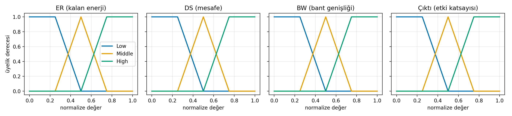
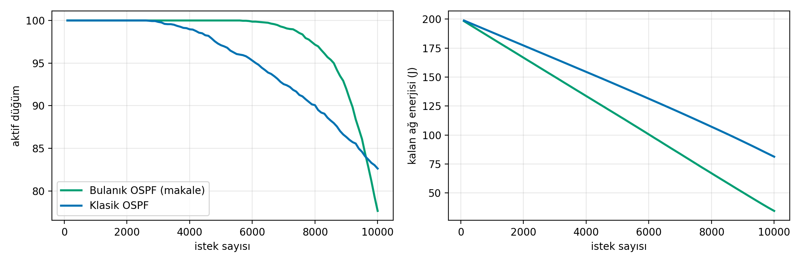
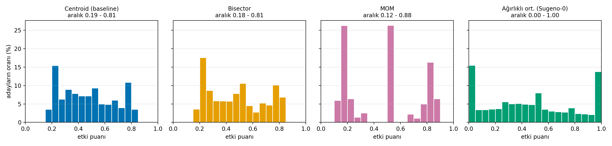
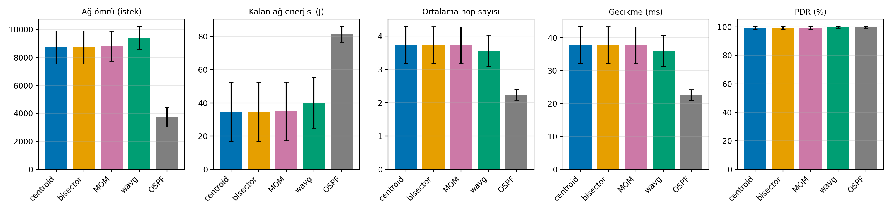
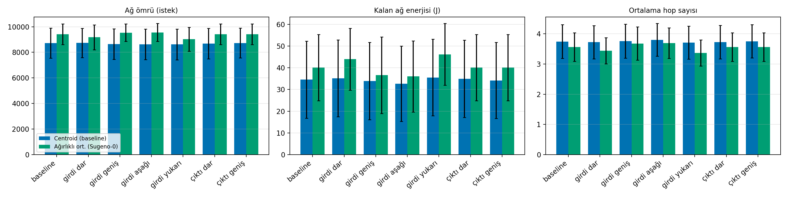

# Bulanık OSPF Yönlendirmede Durulaştırma Yönteminin Etkisi

Akıllı sulama makalesindeki bulanık mantıklı OSPF yönlendirme bileşeninin yeniden gerçekleştirilmesi ve durulaştırma yöntemlerinin karşılaştırılması. Bulanık Mantık dersi dönem projesi.

## Project Title

**Bulanık OSPF Yönlendirmede Durulaştırma Yönteminin Etkisi: Akıllı Sulama Makalesindeki Yönlendirme Bileşeninin Yeniden Gerçekleştirilmesi ve Genişletilmesi**

## Student Information

 Nurgül Gün / 1306220028

## Original Paper

X. Liu, Z. Zhao and A. Rezaeipanah, **“Intelligent and automatic irrigation system based on internet of things using fuzzy control technology”**, *Scientific Reports*, vol. 15, Art. no. 14577, 2025. DOI: [10.1038/s41598-025-98137-2](https://doi.org/10.1038/s41598-025-98137-2)

Makalede kod veya simülatör bağlantısı yoktur; bu projedeki bütün kod sıfırdan yazılmıştır. **Resmi yazar kodu kullanılmamıştır ve dış kaynaklardan kod alınmamıştır.**

## Problem Description

Tarımsal sulamada pille çalışan sensör düğümleri veriyi bir merkeze (SIU) iletir. Verinin hangi yoldan gideceği, ağın ne kadar süre ayakta kalacağını belirler. Makale üç bileşenli bir sistem önerir: (1) beş girdili bir Mamdani sulama sistemi, (2) sulama yöntemini seçen bir derin sinir ağı, (3) OSPF'i bulanık mantıkla genişleten bir yönlendirme algoritması. Makalenin bütün sayısal deneyleri yalnızca üçüncüyü ölçer.

**Bu projede yeniden gerçekleştirilen bölüm (MRR): bulanık OSPF yönlendirme sistemi.** Sulama bulanık sistemi ve DNN yeniden üretilmemiştir; makale bunlar için kural tabanını, üyelik parametrelerini ve eğitim verisini vermemektedir (ayrıntı için [Limitations](#limitations)).

**Özgün katkı:** Merkeze veri taşırken her aday komşuya verilen puanın durulaştırma yöntemi (centroid, bisector, MOM, ağırlıklı ortalama) sonucu ne kadar etkiler? Ayrıca üyelik eşiklerine (r, s, t) duyarlılık analizi.

## Method

**Makalenin algoritması** (yeniden gerçekleştirilen bölüm):

1. Kaynak düğüm "mevcut düğüm" olur.
2. Menzil içindeki komşular aday sayılır.
3. Her aday için bulanık sistem bir **etki katsayısı** hesaplar.
4. Sonraki düğüm **rulet tekerleği** ile seçilir (seçilme olasılığı = puan / puanlar toplamı).
5. SIU'ya ulaşılana kadar tekrarlanır.

**Referans:** Klasik OSPF (bant genişliğine göre 1/BW maliyetli en kısa yol, Dijkstra), aynı ağlarda koşturulur.

**Katkı:** Aynı bulanık sistemde yalnızca durulaştırma adımı değiştirilir; kurallar, üyelik fonksiyonları ve simülatör aynı kalır.

## Fuzzy System Architecture

```
ER, DS, BW  (her biri [0,1]'e normalize)
   │  bulanıklaştırma: Low / Middle / High  (r, s, t = 0.25 / 0.5 / 0.75)
   ▼
12 kural (makale Tablo 3)   VE = çarpım,  VEYA = max
   │  implikasyon = min (kırpma),  birleştirme = max
   ▼
durulaştırma:  centroid (makale)  |  bisector  |  MOM  |  ağırlıklı ortalama (Sugeno-0)
   ▼
etki katsayısı ∈ [0,1]  →  rulet seçimi  →  sonraki düğüm
```

**Girdiler ve çıktı**

| Değişken | Anlamı | Normalizasyon |
|---|---|---|
| ER | Adayın kalan enerjisi | enerji / E₀ |
| DS | (d(aday, mevcut) + d(aday, SIU)) / 2 | DS_max'a bölünür |
| BW | Mevcut düğüm ile aday arasındaki bağlantının bant genişliği | BW / 10 Mbps |
| **Çıktı** | Etki katsayısı | [0, 1] |

**Üyelik fonksiyonları** (makale Denklem 13–15, r < s < t): Low (x < r için 1, r..s arasında düşer), Middle (r'de 0, s'de 1, t'de 0 olan üçgen), High (s..t arasında yükselir, x ≥ t için 1). Eşikler `src/config.py` içindeki `MF_PARAMS` ile tek yerden değiştirilir.



**Kural tabanı** (makale Tablo 3, aynen kodlanmıştır; Kural 7/12 ve 8/11 çelişkilidir ve değiştirilmemiştir):

| # | BW | DS | ER | Çıktı |
|---|---|---|---|---|
| 1 | Low ∨ Mid | Low | Low | Low |
| 2 | High | Low | Low | Mid |
| 3 | Low ∨ Mid ∨ High | High ∨ Mid | Low | Low |
| 4 | Low | Low | Mid ∨ High | Mid |
| 5 | Mid ∨ High | Low | Mid | High |
| 6 | Low ∨ Mid | Mid | Mid | Mid |
| 7 | Low ∨ Mid | High | Mid ∨ High | Low |
| 8 | High | High | Mid | Mid |
| 9 | Mid ∨ High | Low | High | High |
| 10 | Low ∨ Mid | Mid | High | Mid |
| 11 | High | Mid ∨ High | High ∨ Mid | High |
| 12 | Mid | High | High | Mid |

**Durulaştırma yöntemleri**

| Yöntem | Ne yapar |
|---|---|
| `centroid` | Birleşik bulanık kümenin ağırlık merkezi (makalenin yöntemi, baseline) |
| `bisector` | Kümenin alanını iki eşit parçaya bölen nokta |
| `mom` | Kümenin en yüksek değerine ulaştığı noktaların ortalaması (mean of maximum) |
| `wavg` | Her kuralın gücü × sabit merkez (Low = 0, Mid = 0,5, High = 1) toplamı / güç toplamı. **Sıfırıncı derece Sugeno'ya denktir** |

Bulanık motor `numpy` ile elle yazılmıştır (`src/fuzzy_system.py`); hiçbir bulanık mantık kütüphanesi kullanılmamıştır.

## Dataset

**Gerçek veri seti kullanılmamıştır.** Her deney için ağ, rastgele tohum (seed) ile simülasyonla üretilir: 100 sensör 100×100 m alana düzgün dağıtılır, SIU merkezde (50, 50) bulunur, 30 m menzildeki düğümler komşudur ve her bağlantıya 1–10 Mbps arası rastgele bir bant genişliği atanır. Seed 0–29 (30 farklı ağ) kullanılır. Bu nedenle `data/` klasörü yoktur.

Literatür taramasında belirlenen, **fakat kullanılmayan** iki veri seti gelecek çalışma olarak önerilir:
- Intel Berkeley Research Lab verisi [14]: 54 sensör, 2004, sıcaklık/nem/ışık/voltaj ve bağlantı olasılıkları.
- Kaur, Bhatt, Raja, sulama verisi [15]: toprak nemi, hava sıcaklığı, nem, motor durumu (CC BY-NC 3.0).

## Installation

```bash
git clone https://github.com/44nurgul/bulanik-mantik-donem-projesi
cd bulanik-mantik-donem-projesi
python -m venv .venv
source .venv/bin/activate          # Windows: .venv\Scripts\activate
pip install -r requirements.txt
```

## Requirements

`requirements.txt`: `numpy>=2.0`, `matplotlib>=3.8`.

Geliştirme ve deneyler **Python 3.14.4, numpy 2.3.5, matplotlib 3.10.7** ile Linux üzerinde (16 çekirdek, 14 GB bellek) yapılmıştır. Diğer Python sürümleri denenmemiştir.

## How to Run

Komutlar depo kökünden çalıştırılır. Sonuçlar `results/tables/` ve `results/figures/` altına yazılır.

```bash
# 1) Baseline: bulanık OSPF (centroid) ve klasik OSPF, 30 ağ   (~2-3 dk)
python experiments/baseline/run_baseline.py

# 2) Bulanık sistemin farklı girdilerle testi, rulet örneği, yüzey grafiği   (saniyeler)
python experiments/baseline/test_fuzzy_inputs.py

# 3) Özgün katkı: 4 durulaştırma yöntemi + klasik OSPF, 30 ağ   (~2 dk, paralel)
python experiments/proposed/run_proposed.py

# 4) Yan analiz: üyelik eşiği duyarlılığı, 7 yapılandırma x 2 yöntem x 30 ağ   (~10 dk, paralel)
python experiments/proposed/run_sensitivity.py

# Üyelik fonksiyonu grafiği
python src/plot_membership.py
```

`run_proposed.py` ve `run_sensitivity.py` için `--workers N` (paralel süreç sayısı) ve `--seeds N` (ilk N ağ) seçenekleri vardır. **Dikkat:** `--seeds` hızlı deneme içindir ve `results/` altındaki dosyaların üzerine yazar.

Bulanık sistemi istenen girdilerle denemek (canlı gösterim) için `experiments/demo.py` kullanılır. Girdiler 0 ile 1 arası normalize değerlerdir (ER: kalan enerji, DS: uzaklık, BW: bant genişliği). Çıktıda üyelik dereceleri, çalışan kurallar ve dört durulaştırma yönteminin puanı görünür:

```bash
python experiments/demo.py                               # soru-cevap şeklinde (boş satır: çıkış)
python experiments/demo.py --er 0.8 --ds 0.2 --bw 0.9    # tek aday
python experiments/demo.py --adaylar "0.9,0.2,0.9;0.5,0.5,0.5;0.15,0.85,0.2"   # 3 aday: puanlar ve rulet olasılıkları
```

Tek satırlık deneme için (`src/` klasöründen):

```bash
cd src
python -c "from fuzzy_system import influence; print(influence([0.7],[0.2],[0.9]))"           # centroid -> ~0.798
python -c "from fuzzy_system import influence; print(influence([0.7],[0.2],[0.9], 'wavg'))"    # ağırlıklı ortalama -> 1.0
```

(Argüman sırası: ER, DS, BW.)

## Repository Structure

```
src/
  config.py            tüm parametreler; her satır [Makale] veya [VARSAYIM] etiketli
  fuzzy_system.py      Mamdani sistemi, üyelik fonksiyonları, kural tabanı, 4 durulaştırma yöntemi
  network.py           rastgele ağ: konumlar, komşuluk, bant genişliği
  simulation.py        enerji modeli, bulanık rulet yönlendirme, klasik OSPF, metrikler
  plot_membership.py   üyelik fonksiyonu grafiği
experiments/baseline/  run_baseline.py, test_fuzzy_inputs.py
experiments/proposed/  run_proposed.py, run_sensitivity.py
experiments/demo.py    canlı gösterim: istenen girdiyle puan, çalışan kurallar, dört yöntemin karşılaştırması
results/figures/       grafikler (PNG)
results/tables/        sonuç tabloları (CSV)
report/                teknik rapor (PDF)
presentation/          sunum (PDF)
references/            kaynakların bu projedeki kullanımı ve doğrulama notları (README.md)
requirements.txt
LICENSE                MIT lisansı (kod için)
```

## Reproduction Experiments

**Yeniden gerçekleştirilen deney:** Makalenin yönlendirme deneyi (100 düğüm, 100×100 m, 10.000 istek; aktif düğüm, kalan enerji, ağ ömrü, gecikme, PDR). Makalenin vermediği veya tutarsız verdiği her parametre için varsayım yapılmıştır; hepsi `src/config.py` içinde `[VARSAYIM]` etiketiyle de görülür:

| Parametre | Makale | Bu çalışma | Gerekçe |
|---|---|---|---|
| Algılama / işleme süresi | 1 s | **T_sense = T_proc = 10 ms** | 1 s ağı 2–3 istekte öldürür; 1 ms'de hiç düğüm ölmedi; 5/10/20 ms denendi |
| ϵ_fs, ϵ_mp, d₀ | ikisi 100 pJ/bit/m² | ϵ_fs = 100 pJ/bit/m², d₀ yalnızca menzil (30 m) | Menzil içinde yalnızca d² kolu geçerli; değerler LEACH ile aynı |
| Üyelik eşikleri (r, s, t) | verilmemiş | hepsi için 0,25 / 0,5 / 0,75 | Duyarlılık analizi yapıldı |
| Çıktı kümeleri | verilmemiş | girdilerle aynı eşikler | Simetrik, savunması kolay |
| İmplikasyon / durulaştırma | çarpım-AND, centroid | min implikasyon, max birleştirme, 101 noktalı centroid | Makalede belirtilmemiş |
| Bant genişliği | verilmemiş | bağlantı başına U(1; 10) Mbps, sabit | Girdilerin bağımsız kalması |
| SIU konumu | verilmemiş | (50, 50), enerjisi sınırsız | Kısa yollar, çok komşu |
| İstek tanımı | verilmemiş | rastgele canlı sensör → SIU, 1 paket | Ağ ömrü = istek sayısı |
| Paket kaybı / döngü | verilmemiş | ziyaret edilenler hariç, TTL = 20, ek link kaybı yok | Makalede olmayan mekanizma eklenmedi |
| SIU menzildeyse | belirtilmemiş | doğrudan SIU'ya gönderilir | Gerçek protokollerde hedef komşuysa doğrudan teslim |
| OSPF güncelleme aralığı | 10 s | modellenmedi, bilgi anında güncel | İstekler arası süre verilmemiş |
| Tekrar sayısı | “birden çok koşu” | 30 seed (0–29) | Rastgele topoloji ve rulet |

Makalenin Tablo 4'teki E_elec = 50 nJ/bit ve ϵ = 100 pJ/bit/m² değerleri, LEACH makalesindeki [13] birinci mertebe radyo modelinin değerleriyle aynıdır; ϵ_fs ve ϵ_mp'nin aynı verilmesi bundan kaynaklanıyor olabilir (çıkarım).

**Makaleyle karşılaştırma** (30 ağ, ortalama ± standart sapma). Makalenin DLQR/SPIS/FWIS yöntemleri sulama kontrolcüsü olduğundan yeniden üretilemez; yalnızca değerleri gösterilir:

| Metrik | Bulanık OSPF (centroid) | Klasik OSPF | Makale (önerilen) | Makale (DLQR/SPIS/FWIS) |
|---|---|---|---|---|
| Ağ ömrü (istek) | 8720 ± 1175 | 3735 ± 696 | 6124 | 3461–5567 |
| Kalan ağ enerjisi (J) | 34.6 ± 17.8 | 81.3 ± 4.8 | 35.12 | 24.85–31.52 |
| Ortalama hop sayısı | 3.74 ± 0.56 | 2.24 ± 0.16 | – | – |
| Gecikme (ms) | 37.8 ± 5.6 | 22.6 ± 1.6 | 11.52 s | 16.93–23.85 s |
| PDR (%) | 99.29 ± 1.06 | 99.72 ± 0.61 | 68.54 | 66.18–67.54 |
| Aktif düğüm sayısı | 77.7 ± 27.0 | 82.6 ± 2.6 | 36 | 10–11 |

Ağ ömrü = ilk düğümün öldüğü istek numarası. Bulanık yöntemin 9/30 ağında 10.000 istekte hiç düğüm ölmemiştir (ömür 10.000 sayılmıştır, **alt sınırdır**). Gecikme biz ms, makale s cinsinden verdiği için mutlak değerler kıyaslanamaz.

**Özet:** Bulanık yöntem ağ ömrünü klasik OSPF'in 2,3 katına çıkarır (yük dağıldığı için ilk ölüm geç gelir); karşılığında daha uzun yol (3,74 hop, klasik 2,24) ve daha yüksek enerji harcaması vardır. Makaleyle yön olarak yalnızca ağ ömründe uyuşuruz; gecikme ve PDR'da uyuşmayız (makale hesaplama ve kayıp mekanizmasını vermiyor).



## Proposed Extension

**Gözlem:** Centroid, birleşik kümenin ağırlık merkezini aldığı için uç puanlara ulaşamaz; puanlar yalnızca **0,19–0,81** aralığında kalır. En iyi aday ile en kötü aday arasındaki rulet şansı farkı yaklaşık 4 kattır, yönlendirme rastgele yürüyüşe yaklaşır. Çıktı eşiklerini değiştirmek bunu çözmez (en uç puanlar 0,165–0,835).

**Hipotez (H1):** Puan aralığını genişleten bir durulaştırma yöntemi paketleri daha uygun komşulara yönlendirir; ağ ömrü, kalan enerji ve hop sayısı iyileşir.

**Deney tasarımı:**
- Aynı 30 ağ (aynı seed, topoloji, bant genişlikleri); yalnızca durulaştırma değişir.
- Metrikler: ağ ömrü, kalan enerji, ortalama hop, gecikme, PDR (+ aktif düğüm).
- Ortalama ± std ve aynı ağlarda eşleşmiş fark ("kaç ağda daha iyi").
- Hipotezi doğrudan göstermek için simülasyonda hesaplanan gerçek etki puanlarının dağılımı (min–max, histogram, sıfır puanlı aday oranı).
- Hesaplama süresi: aynı girdilerle tekrarlı, kontrollü mikro test.
- Yan analiz: üyelik eşikleri (girdi eşikleri ve çıktı eşikleri ayrı ayrı) 7 yapılandırmada, centroid ve ağırlıklı ortalama ile.

**Not:** Ağırlıklı ortalamada bazı adayların puanı tam 0 olur (rulette hiç seçilmezler). Tüm adayların puanı 0 çıkarsa yedek kural olarak eşit olasılıklı seçim yapılır ve bu durum sayılır.

## Experimental Results

**Beş yöntem, 30 ağ (ortalama ± std):**

| Metrik | Centroid (baseline) | Bisector | MOM | Ağırlıklı ort. | Klasik OSPF |
|---|---|---|---|---|---|
| Ağ ömrü (istek) | 8720 ± 1175 | 8717 ± 1173 | 8811 ± 1075 | 9410 ± 813 | 3735 ± 696 |
| Kalan ağ enerjisi (J) | 34.6 ± 17.8 | 34.5 ± 17.7 | 34.9 ± 17.6 | 40.1 ± 15.3 | 81.3 ± 4.8 |
| Ortalama hop sayısı | 3.74 ± 0.56 | 3.74 ± 0.55 | 3.73 ± 0.55 | 3.56 ± 0.47 | 2.24 ± 0.16 |
| Gecikme (ms) | 37.8 ± 5.6 | 37.8 ± 5.6 | 37.7 ± 5.5 | 36.0 ± 4.8 | 22.6 ± 1.6 |
| PDR (%) | 99.29 ± 1.06 | 99.27 ± 1.12 | 99.31 ± 1.07 | 99.73 ± 0.54 | 99.72 ± 0.61 |
| Aktif düğüm sayısı | 77.7 ± 27.0 | 77.7 ± 26.7 | 78.7 ± 25.8 | 92.4 ± 17.5 | 82.6 ± 2.6 |

Ağ ömrü alt sınır (hiç düğüm ölmeyen ağ sayısı): centroid 9, bisector 9, MOM 8, ağırlıklı ort. 14, klasik OSPF 0.

**Baseline ↔ geliştirilen (ağırlıklı ortalama), eşleşmiş fark:**

| Performans ölçütü | Baseline | Geliştirilen | Değişim | Fark std | Daha iyi (ağ) |
|---|---|---|---|---|---|
| Ağ ömrü (istek) | 8720 | 9410 | +690 (+7.9%) | 561 | 21/30 |
| Kalan ağ enerjisi (J) | 34.6 | 40.1 | +5.5 (+16.0%) | 3.6 | 29/30 |
| Ortalama hop sayısı | 3.74 | 3.56 | -0.18 (-4.7%) | 0.11 | 29/30 |
| Gecikme (ms) | 37.8 | 36.0 | -1.8 (-4.8%) | 1.1 | 29/30 |
| PDR (%) | 99.29 | 99.73 | +0.44 (+0.4%) | 0.59 | 25/30 |
| Aktif düğüm sayısı | 77.7 | 92.4 | +14.7 (+18.9%) | 16.2 | 21/30 |

**Puan aralığı, sıfır puan ve hesaplama süresi:**

| Yöntem | Puan min | Puan max | Sıfır puanlı aday (%) | “Tüm adaylar 0” (ağ başına) | Süre (µs/çağrı, 20 aday) |
|---|---|---|---|---|---|
| Centroid (baseline) | 0.192 | 0.808 | 0.0 | 0 | 127 |
| Bisector | 0.180 | 0.810 | 0.0 | 0 | 133 |
| MOM | 0.125 | 0.875 | 0.0 | 0 | 134 |
| Ağırlıklı ort. (Sugeno-0) | 0.000 | 1.000 | 10.6 | 680 | 114 |





**Bulgular:**
- **Bisector** (puan aralığı 0,18–0,81) centroid'ten ayırt edilemez; beklenen kontrol sonucu.
- **MOM** aralığı 0,125–0,875'e genişletir ama yalnızca üç farklı değer üretir; belirgin fark yoktur.
- **Ağırlıklı ortalama** (aralık 0–1) kalan enerji, hop ve gecikmede 30 ağın 29'unda, PDR'da 25'inde, ağ ömründe ve aktif düğümde 21'inde centroid'ten iyidir. Ağ ömrü farkı (+690 istek) standart sapmaya (561) göre daha zayıf kanıttır.
- Sonuçlar H1 ile **uyumludur**, fakat nedenselliği **kanıtlamaz**: ağırlıklı ortalama aralığı genişletmenin yanında sıfır puanlı adayları eler, yedek kuralı devreye sokar ve farklı bir yapıdır (Sugeno).

**Üyelik eşiği duyarlılığı** (Δ = ağırlıklı ortalama − centroid, parantezde daha iyi olduğu ağ sayısı):

| Yapılandırma | Girdi (r/s/t) | Çıktı (r/s/t) | Ömür (centroid) | Ömür (wavg) | Δ Ömür | Δ Enerji (J) | Δ Hop |
|---|---|---|---|---|---|---|---|
| baseline | 0.25/0.5/0.75 | 0.25/0.5/0.75 | 8720 | 9410 | +690 (21/30) | +5.5 (29/30) | -0.18 (29/30) |
| girdi dar | 0.35/0.5/0.65 | 0.25/0.5/0.75 | 8737 | 9178 | +441 (21/30) | +8.9 (29/30) | -0.28 (29/30) |
| girdi geniş | 0.1/0.5/0.9 | 0.25/0.5/0.75 | 8649 | 9531 | +882 (22/30) | +2.6 (28/30) | -0.08 (28/30) |
| girdi aşağı | 0.2/0.4/0.6 | 0.25/0.5/0.75 | 8622 | 9551 | +929 (23/30) | +3.4 (29/30) | -0.11 (30/30) |
| girdi yukarı | 0.4/0.6/0.8 | 0.25/0.5/0.75 | 8619 | 9022 | +403 (21/30) | +10.6 (30/30) | -0.34 (30/30) |
| çıktı dar | 0.25/0.5/0.75 | 0.4/0.5/0.6 | 8686 | 9410 | +724 (21/30) | +5.2 (28/30) | -0.16 (28/30) |
| çıktı geniş | 0.25/0.5/0.75 | 0.05/0.5/0.95 | 8730 | 9410 | +680 (21/30) | +5.9 (30/30) | -0.19 (30/30) |

Centroid eşiklere neredeyse duyarsızdır. Ağırlıklı ortalamanın üstünlüğü yedi yapılandırmanın hepsinde korunur; çıktı eşiklerinden bağımsızdır (sabit merkez kullanır), girdi eşiklerinden etkilenir.



Tüm ham sonuçlar `results/tables/` altındadır (`*_per_seed.csv`: seed bazında, `*_summary.csv`: özet). Ayrıntılı analiz ve tartışma için teknik rapora bakınız.

## Limitations

- Sulama bulanık sistemi ve DNN yeniden üretilmemiştir.
- Algılama ve işleme süresi (10 ms) makaleden farklıdır ve makale sonuçlarına göre kalibre edilmemiştir; enerji dengesi (işleme baskın) bu seçime bağlıdır.
- Ağ ömrü sansürlüdür (bulanık yöntemlerde 8–14 ağda hiç düğüm ölmemiştir); değerler alt sınırdır.
- PDR yalnızca çıkmaz ve TTL kayıplarını sayar; makalenin %68,5'lik PDR'ı açıklanamamıştır. Gecikme modeli basittir, mutlak değerler makaleyle kıyaslanamaz.
- OSPF'in 10 s'lik güncelleme aralığı modellenmemiş, komşu bilgisi her zaman güncel kabul edilmiştir (bulanık yönteme hafif avantaj olabilir).
- Ağırlıklı ortalamadaki iyileşmenin nedeni (aralık genişlemesi, sıfır puanlıları eleme, yedek kural, Sugeno yapısı) ayrıştırılamamıştır; biçimsel anlamlılık testi yapılmamıştır.
- Kural tabanındaki çelişkiler değiştirilmemiştir; bulanık motor üçüncü taraf bir kütüphaneyle çapraz doğrulanmamıştır.
- Tek ağ boyutu (100 düğüm), tek SIU konumu, yalnızca simülasyon.

**Üretken yapay zekâ kullanımı:** Ayrıntılar teknik raporun *Generative AI Usage Disclosure* bölümündedir.

## References

[1] X. Liu, Z. Zhao, and A. Rezaeipanah, “Intelligent and automatic irrigation system based on internet of things using fuzzy control technology,” *Sci. Rep.*, vol. 15, Art. no. 14577, 2025, doi: 10.1038/s41598-025-98137-2.

[2] V. Pandiyaraju, R. Logambigai, S. Ganapathy, and A. Kannan, “An energy efficient routing algorithm for WSNs using intelligent fuzzy rules in precision agriculture,” *Wireless Pers. Commun.*, vol. 112, no. 1, pp. 243–259, 2020, doi: 10.1007/s11277-020-07024-8.

[3] J. Gong and A. Rezaeipanah, “A fuzzy delay-bandwidth guaranteed routing algorithm for video conferencing services over SDN networks,” *Multimedia Tools Appl.*, vol. 82, no. 17, pp. 25585–25614, 2023, doi: 10.1007/s11042-023-14349-6.

[4] H. Hu, X. Fan, and C. Wang, “Efficient cluster-based routing protocol for wireless sensor networks by using collaborative-inspired Harris Hawk optimization and fuzzy logic,” *PLoS ONE*, vol. 19, no. 4, Art. no. e0301470, 2024, doi: 10.1371/journal.pone.0301470.

[5] H. Hu, X. Fan, C. Wang, T. Wang, and Y. Deng, “Particle swarm optimization and fuzzy logic based clustering and routing protocol to enhance lifetime for wireless sensor networks,” *Cluster Comput.*, vol. 27, pp. 9715–9734, 2024, doi: 10.1007/s10586-024-04453-z.

[6] M. Bukhari, S. O. Athar, M. Ullah, and M. N. Aman, “A fuzzy-logic-based smart irrigation controller for precision agriculture,” *IEEE Internet Things J.*, vol. 11, no. 22, pp. 37257–37268, 2024.

[7] M. Benzaouia, B. Hajji, A. Mellit, and A. Rabhi, “Fuzzy-IoT smart irrigation system for precision scheduling and monitoring,” *Comput. Electron. Agric.*, vol. 215, Art. no. 108407, 2023, doi: 10.1016/j.compag.2023.108407.

[8] R. B. Dhumale *et al.*, “Fuzzy Internet of Things-based water irrigation system,” *Agric. Eng. Int.: CIGR J.*, vol. 25, no. 2, 2023.

[9] E. H. Mamdani and S. Assilian, “An experiment in linguistic synthesis with a fuzzy logic controller,” *Int. J. Man-Mach. Stud.*, vol. 7, no. 1, pp. 1–13, 1975, doi: 10.1016/S0020-7373(75)80002-2.

[10] T. Takagi and M. Sugeno, “Fuzzy identification of systems and its applications to modeling and control,” *IEEE Trans. Syst., Man, Cybern.*, vol. SMC-15, no. 1, pp. 116–132, 1985.

[11] S. Roychowdhury and W. Pedrycz, “A survey of defuzzification strategies,” *Int. J. Intell. Syst.*, vol. 16, no. 6, pp. 679–695, 2001, doi: 10.1002/int.1030.

[12] W. Van Leekwijck and E. E. Kerre, “Defuzzification: Criteria and classification,” *Fuzzy Sets Syst.*, vol. 108, no. 2, pp. 159–178, 1999, doi: 10.1016/S0165-0114(97)00337-0.

[13] W. R. Heinzelman, A. Chandrakasan, and H. Balakrishnan, “Energy-efficient communication protocol for wireless microsensor networks,” in *Proc. 33rd Hawaii Int. Conf. Syst. Sci. (HICSS)*, 2000.

[14] P. Bodik, W. Hong, C. Guestrin, S. Madden, M. Paskin, and R. Thibaux, “Intel Lab Data,” Intel Berkeley Research Lab / MIT CSAIL, 2004. https://db.csail.mit.edu/labdata/labdata.html

[15] A. Kaur, D. P. Bhatt, and L. Raja, “Soil moisture, air temperature, humidity, and motor on/off monitoring data,” Mendeley Data, v1, 2023, doi: 10.17632/fpdwmm7nrb.1.
